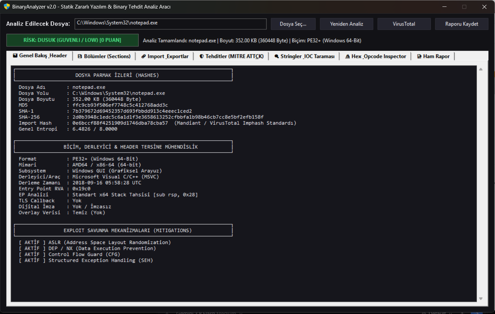
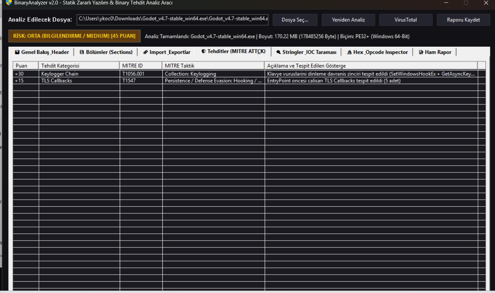
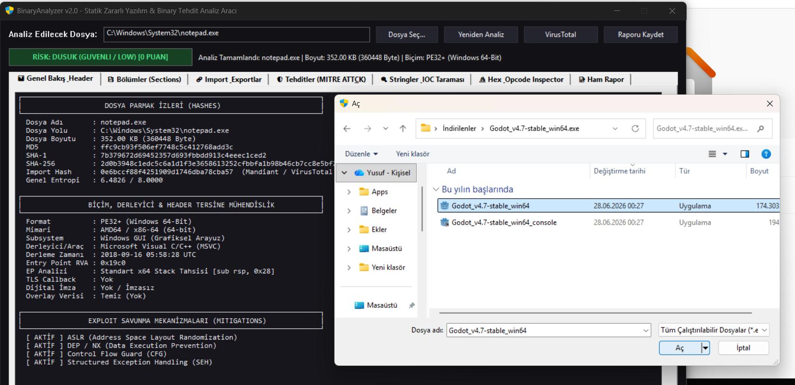

<div align="center">

# 🛡️ BinaryAnalyzer v2.0
### Advanced Static Binary & Malware Threat Triage Platform

[](https://en.cppreference.com/)
[](https://microsoft.com/windows)
[](https://en.wikipedia.org/wiki/X86-64)
[](https://attack.mitre.org/)
[](LICENSE)

<p align="center">
  <b>BinaryAnalyzer</b> is a lightweight, high-performance static binary analysis and threat triage engine written in modern C++. It analyzes Windows Portable Executable (<b>PE32/PE32+</b>) and Linux <b>ELF</b> binaries, computes standard <b>Imphash</b>, maps suspicious indicators directly to the <b>MITRE ATT&CK®</b> framework, detects compiler signatures, inspects entry point disassembly, and calculates threat scores with zero false-positive calibration.
</p>

<p align="center">
  <b>Language:</b> <a href="README.md">English</a> • <a href="README.tr.md">Türkçe</a>
</p>

[Key Features](#-key-features) • [Screenshots](#-screenshots) • [MITRE ATT&CK Mapping](#-mitre-attck-threat-scoring) • [Building & Installation](#-building-from-source) • [Usage](#-usage)

---

</div>

## 📸 Screenshots

### 1. Dark Mode Overview & Hashes
> Displaying file fingerprints (MD5, SHA-1, SHA-256), Mandiant/VirusTotal standard Imphash, compiler identification, and exploit mitigation telemetry (ASLR, DEP, CFG, SEH).



---

### 2. Static Malware Findings & MITRE ATT&CK® Matrix
> Suspicious API behaviors and persistence indicators mapped directly to official MITRE ATT&CK techniques and tactics.



---

### 3. Compiler Detection, TLS Callbacks & Overlay Inspection
> Deep inspection on complex binaries (e.g., Godot Engine) identifying Rust tooling, TLS callback addresses, and appended digital signature overlay data.


---

### 4. Fast File Selection & Drag-and-Drop
> Rapid file picker dialog or instant drag-and-drop support for any `.exe`, `.dll`, or `ELF` binary.



---

## ✨ Key Features

### 🔍 1. Comprehensive PE & ELF Parsing
- **Formats & Architectures:** PE32 (32-bit), PE32+ (64-bit AMD64/ARM64), ELF32, ELF64, Little/Big Endian.
- **Headers & Telemetry:** DOS MZ Header, COFF File Header, Optional Header, Subsystem classification, ImageBase, EntryPoint, Compilation Timestamp.
- **Section & Shannon Entropy Analysis:**
  - Evaluates Virtual/Raw sizes and section permissions (Read/Write/Execute).
  - **Shannon Entropy (0.00 - 8.00):** Accurately flags obfuscated, packed, or compressed code sections.
- **Exploit Mitigations:** ASLR (Dynamic Base), DEP/NX, Control Flow Guard (CFG), and SafeSEH status.
- **Digital Signatures & Overlays:** Authenticode presence and appended payload detection.

### 🛡️ 2. Standard Imphash (Import Hash) Engine
- Compliant with Mandiant / FireEye and VirusTotal import hash calculation standards.
- Normalizes library extensions (`.dll`, `.sys`, `.ocx`), ordinals, and imported symbols to lowercase before hashing with MD5.
- Allows rapid correlation and malware family tracking across variants.

### 🎯 3. MITRE ATT&CK® Threat Mapping
Static behavioral indicators are categorized and mapped directly to MITRE ATT&CK techniques:
| Indicator / Behavioral Chain | MITRE ATT&CK ID | MITRE ATT&CK Tactic & Description |
|---|---|---|
| **Process Injection Chain** (`VirtualAllocEx` + `WriteProcessMemory` / `CreateRemoteThread`) | `T1055` | Defense Evasion / Privilege Escalation |
| **Software Packing / Encryption** (High Entropy Executable Section) | `T1027.002` | Defense Evasion: Software Packing |
| **Input Capture / Keylogging** (`SetWindowsHookEx` + `GetAsyncKeyState`) | `T1056.001` | Collection: Keylogging |
| **Time-Based Evasion / Sandbox Delay** (`SleepEx`, `NtDelayExecution`) | `T1497.003` | Defense Evasion: Time Based Evasion |
| **Anti-Debugging / Analysis Detection** (`IsDebuggerPresent`, `CheckRemoteDebuggerPresent`) | `T1497` | Defense Evasion: Virtualization/Sandbox Evasion |
| **TLS Callback Execution** (Pre-EntryPoint Code Execution) | `T1547.001` | Persistence / Defense Evasion: Hooking |
| **Inhibit System Recovery** (`vssadmin delete shadows`) | `T1490` | Impact: Inhibit System Recovery (Ransomware) |
| **Ingress Tool Transfer** (`URLDownloadToFile`, `WinHttpOpen`) | `T1105` | Command and Control: Ingress Tool Transfer |

### 🔬 4. Compiler & Tooling Fingerprinting
Static signatures and artifact patterns detect the underlying build environment:
- **Microsoft Visual C/C++ (MSVC)**
- **MinGW / GCC**
- **Rust (`rustc`)**
- **Go (`runtime.main` / Go build IDs)**
- **Embarcadero Delphi / FreePascal**
- **.NET / CLR Runtime Header**

### ⚡ 5. Entry Point Hex & Disassembly Inspector
- Dumps the first 64 bytes at the binary entry point with address offsets, hexadecimal bytes, and printable ASCII representation.
- **Automated Prologue Classification:**
  - `sub rsp, xx` (Standard x64 Stack Frame Allocation)
  - `push ebp; mov ebp, esp` (Standard x86 Stack Frame Setup)
  - `jmp [IAT]` (Indirect Import Address Table Jump)
  - `xor ebp, ebp` (ELF ABI Initialization Routine)

### 🎨 6. Modern Win32 Dark Mode GUI
- Native Win32 desktop application with zero heavy external UI dependencies.
- `#121214` dark palette with crisp Segoe UI and Consolas typography.
- **7 Dedicated Tabs:**
  1. 📋 **Overview & Header:** Hashes, Imphash, compiler info, exploit defenses.
  2. 📑 **Sections & Entropy:** Section table, RWX permissions, entropy values.
  3. 🔗 **Imports & Exports:** Dependent libraries and exported/imported symbols.
  4. 🛡️ **Threats (MITRE ATT&CK):** Threat score, category, detail, MITRE IDs.
  5. 🔍 **Strings & IOCs:** Extracted URLs, IP addresses, registry paths.
  6. 💻 **Hex & Disassembly:** Entry point opcode dump and prologue classification.
  7. 📄 **Raw Report:** Full report view, clipboard copy, and export to TXT, JSON, or HTML.
- **One-Click VirusTotal Lookup:** Instantly query the binary SHA-256 hash in your browser.
- **Drag-and-Drop:** Drop any executable onto the window to trigger immediate analysis.

---

## 🏗️ Architecture & Project Structure

```
BinaryAnalyzer/
├── CMakeLists.txt            # CMake build configuration
├── BinaryAnalyzerGUI.cpp     # Native Win32 Dark Mode Desktop GUI Application
├── BinaryAnalyzer.cpp        # Fast and lightweight Console (CLI) Application
├── AnalyzerEngine.h / .cpp   # Shared analysis pipeline, JSON & HTML report generator
├── PEParser.h / .cpp         # PE32/PE32+ parser, Imphash, TLS & Opcode engine
├── ELFParser.h / .cpp        # Linux ELF32/ELF64 binary parser
├── MalwareAnalyzer.h / .cpp  # MITRE ATT&CK threat evaluator and heuristic rules
├── BinaryFile.h / .cpp       # Memory-mapped binary reader, MD5/SHA-1/SHA-256 & Entropy
├── IParser.h                 # Extensible parser interface
├── screenshots/              # High-resolution application screenshots
└── .vscode/                  # Preconfigured VS Code tasks and debug profiles
```

---

## 🛠️ Building from Source

### Prerequisites
- **Operating System:** Windows 10 or Windows 11 (x64 / x86)
- **Compiler:** Microsoft Visual Studio 2022 (MSVC v143) or Clang/LLVM
- **Build System:** CMake 3.20 or later

### 1. Clone the Repository
```bash
git clone https://github.com/YusufKoc05/BinaryAnalyzer.git
cd BinaryAnalyzer
```

### 2. Configure and Build with CMake
```powershell
# Configure build files
cmake -B build -S .

# Build in Release configuration
cmake --build build --config Release
```

The compiled binaries will be generated under `build/Release/` (or `build/Debug/`):
- `BinaryAnalyzerGUI.exe` -> Desktop GUI Application
- `BinaryAnalyzer.exe` -> Command-Line (CLI) Tool

---

## 💻 Usage

### 🖥️ Desktop GUI
1. Launch `BinaryAnalyzerGUI.exe`.
2. Click **Dosya Seç... (Browse)** or simply **drag and drop** a binary into the window.
3. Switch between tabs to explore headers, MITRE ATT&CK detections, Imphash, and hex disassembly.
4. Export the findings via **Raporu Kaydet...** (Text, JSON, or HTML) or copy to clipboard.
5. Click **VirusTotal** to inspect the hash on VirusTotal.

### ⌨️ Command Line (CLI)
For automated pipelines or rapid terminal analysis:
```powershell
# Analyze a specific binary
.\BinaryAnalyzer.exe C:\Windows\System32\notepad.exe

# Or run interactively and drag a file path into the console:
.\BinaryAnalyzer.exe
```

---

## 🔒 Security & Privacy Notice
* **100% Offline Static Analysis:** BinaryAnalyzer performs purely local static analysis. No binary files or extracted payloads are ever transmitted to external servers.
* **Non-Executing Environment:** The target binary is parsed strictly as passive byte data; it is never executed by the analysis engine.

---

## 📜 License
This project is licensed under the [MIT License](LICENSE).

---

<div align="center">
  Author: <b><a href="https://github.com/YusufKoc05">Yusuf Koç</a></b><br>
  <i>Reverse Engineering • Malware Analysis • Threat Intelligence • Modern C++</i>
</div>
