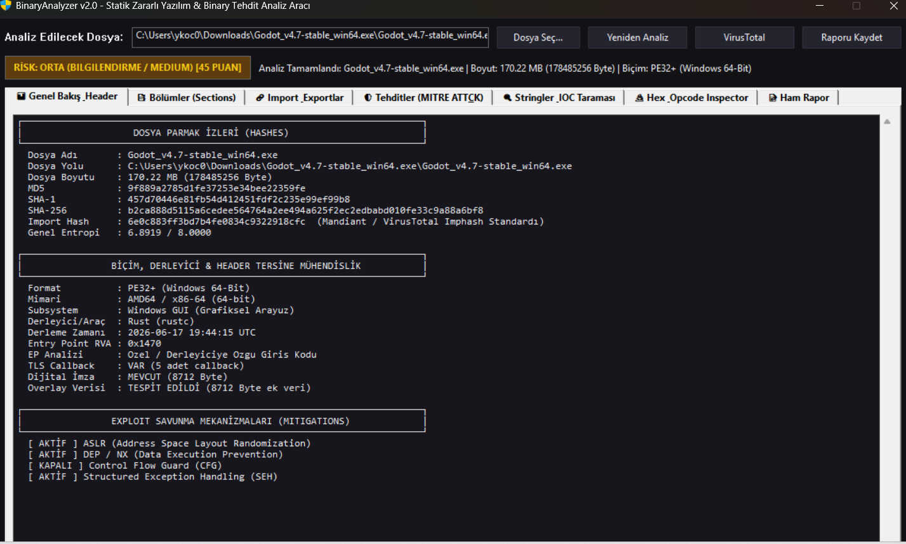

<div align="center">

# 🛡️ BinaryAnalyzer v2.0
### Advanced Static Binary & Malware Threat Analyzer

[](https://en.cppreference.com/)
[](https://microsoft.com/windows)
[](https://en.wikipedia.org/wiki/X86-64)
[](https://attack.mitre.org/)
[](LICENSE)

<p align="center">
  <b>BinaryAnalyzer</b> is a high-performance, native C++ static analysis and malware threat triage platform designed for reverse engineers, SOC analysts, and security researchers. It performs deep structural analysis of Windows Portable Executable (<b>PE32/PE32+</b>) and Linux <b>ELF</b> binaries, calculates industry-standard <b>Imphash</b>, maps suspicious indicators directly to the <b>MITRE ATT&CK®</b> matrix, detects compilers/packers, analyzes Entry Point opcodes, and evaluates threats through an intelligent, zero-false-positive scoring engine.
</p>

[✨ Özellikler](#-temel-özellikler) • [📸 Ekran Görüntüleri](#-ekran-görüntüleri) • [📊 Tehdit & MITRE ATT&CK](#-mitre-attck-ve-tehdit-puanlama-motoru) • [🛠️ Kurulum & Derleme](#-kurulum-ve-derleme) • [💻 Kullanım](#-kullanım)

---

</div>

## 📸 Ekran Görüntüleri (Screenshots)

### 1. Koyu Tema Genel Bakış, Hashes & Imphash (Dark Mode Overview)
> Dosya parmak izleri (MD5, SHA-1, SHA-256), Mandiant/VirusTotal standardında Imphash, derleyici parmak izi ve exploit savunma mitigasyonları (ASLR, DEP, CFG, SEH).


---

### 2. Statik Tehdit Analizi & MITRE ATT&CK® Matris Eşleştirmesi
> Şüpheli API çağrıları, davranış zincirleri ve persistence göstergelerinin resmi MITRE ATT&CK teknik ve taktik kodlarıyla listelenmesi.


---

### 3. Gelişmiş İkili Dosya & Derleyici Tespiti (Rust, TLS Callbacks, Overlay)
> Büyük ölçekli binary dosyalarında (Godot Engine vb.) Rust derleyici tespiti, 5 adet TLS Callback fonksiyonu ve dijital imza/overlay analizi.



---

### 4. Hızlı Dosya Seçimi & Sürükle-Bırak Entegrasyonu
> Tek tıkla dosya seçimi veya herhangi bir `.exe` / `.dll` / `ELF` dosyasını arayüze sürükleyip anında analiz başlatma.


---

## ✨ Temel Özellikler

### 🔍 1. Kapsamlı PE & ELF Ayrıştırıcı (Binary Parsing Engine)
- **Format & Mimari:** PE32 (32-bit), PE32+ (64-bit AMD64/ARM64), ELF32, ELF64, Little/Big Endian desteği.
- **Header Analizi:** DOS MZ Header, COFF File Header, Optional Header, Subsystem (GUI / CUI / Driver), ImageBase, EntryPoint, Derleme Zamanı (TimeDateStamp).
- **Section & Shannon Entropi Analizi:**
  - Her bir bölümün (`.text`, `.rdata`, `.data`, `.rsrc`, `.reloc` vb.) Virtual/Raw boyutları, bellek izinleri (Read/Write/Execute).
  - **Shannon Entropisi (0.00 - 8.00):** Şifrelenmiş, paketlenmiş (packed) veya sıkıştırılmış kod bölümlerinin tespiti.
- **Güvenlik Mitigasyonları:** ASLR (Dynamic Base), DEP/NX (No-Execute), Control Flow Guard (CFG), SafeSEH kontrolü.
- **Dijital İmza & Overlay:** PE Authenticode sertifika varlığı ve dosya sonuna iliştirilmiş gizli veri (Overlay) tespiti.

### 🛡️ 2. Standart Imphash (Import Hash) Hesaplama
- Mandiant / FireEye ve VirusTotal standardına tam uyumlu Imphash algoritması.
- DLL uzantılarını (`.dll`, `.sys`, `.ocx`) normalize ederek, ordinalleri ve API fonksiyon isimlerini küçük harfe dönüştürüp sıralı MD5 özeti üretir.
- Zararlı yazılım ailelerinin (malware families) varyantlarını import tablosundan anında eşleştirmeyi sağlar.

### 🎯 3. MITRE ATT&CK® Matrisi ile Otomatik Tehdit Haritalama
Tüm statik bulgular, resmi MITRE ATT&CK teknik ve taktik kimlikleriyle ilişkilendirilir:
| Tespit Edilen Gösterge | MITRE ATT&CK ID | MITRE ATT&CK Taktik & Açıklama |
|---|---|---|
| **Process Injection Zinciri** (`VirtualAllocEx` + `WriteProcessMemory` / `CreateRemoteThread`) | `T1055` | Defense Evasion / Privilege Escalation |
| **Yazılım Paketleme / Şifreleme** (Yüksek Entropili Executable Bölüm) | `T1027.002` | Defense Evasion: Software Packing |
| **Giriş Dinleme / Keylogger** (`SetWindowsHookEx` + `GetAsyncKeyState`) | `T1056.001` | Collection: Keylogging |
| **Zaman Aşımı / Sandbox Geciktirme** (`SleepEx`, `NtDelayExecution`) | `T1497.003` | Defense Evasion: Time Based Evasion |
| **Anti-Debugging / Analiz Engelleme** (`IsDebuggerPresent`, `CheckRemoteDebuggerPresent`) | `T1497` | Defense Evasion: Virtualization/Sandbox Evasion |
| **TLS Callback Fonksiyonları** (EntryPoint Öncesi Gizli Kod Çalıştırma) | `T1547.001` | Persistence / Defense Evasion: Hooking |
| **Gölge Kopyaları Silme** (`vssadmin delete shadows`) | `T1490` | Impact: Inhibit System Recovery (Ransomware) |
| **Uzak Komut İndirme & Yürütme** (`URLDownloadToFile`, `WinHttpOpen`) | `T1105` | Command and Control: Ingress Tool Transfer |

### 🔬 4. Derleyici & Araç Tespiti (Compiler Fingerprinting)
Statik parmak izi analiziyle binary'nin hangi derleyici veya dille oluşturulduğunu tespit eder:
- **Microsoft Visual C/C++ (MSVC)**
- **MinGW / GCC**
- **Rust (`rustc`)**
- **Go (`runtime.main` / Go build IDs)**
- **Embarcadero Delphi / FreePascal**
- **.NET / CLR Header** (C#, VB.NET, F#)

### ⚡ 5. Entry Point Hex & Disassembly Inspector
- Programın giriş noktasındaki (`EntryPoint`) ilk 64 baytlık makine kodunu ofset adresleri, hex baytları ve ASCII karşılığıyla gösterir.
- **Prologue Sınıflandırması:**
  - `sub rsp, xx` (Modern 64-bit Stack Frame Tahsisi)
  - `push ebp; mov ebp, esp` (Klasik 32-bit cdecl/stdcall Frame)
  - `jmp [IAT]` (Import Adres Tablosu dolaylı atlama)
  - `xor ebp, ebp` (ELF ABI başlangıç rutini)

### 🎨 6. Modern Win32 Koyu Tema Arayüzü (Dark Mode GUI)
- Harici hantal kütüphanelere ihtiyaç duymayan, saf C++ Win32 API ile geliştirilmiş son derece hafif ve modern arayüz.
- `#121214` koyu arka plan, kontrastlı Segoe UI & Consolas tipografisi.
- **7 Organize Sekme:**
  1. 📋 **Genel Bakış & Header:** Dosya hashes, Imphash, derleyici, exploit mitigasyonları.
  2. 📑 **Bölümler (Sections) & Entropi:** Bölüm listesi, izinler (RWX bayrakları), entropi skorları.
  3. 🔗 **Import & Exportlar:** Bağımlı DLL'ler ve dışa/içe aktarılan fonksiyonlar.
  4. 🛡️ **Tehditler (MITRE ATT&CK):** Puan, kategori, açıklama, MITRE ID ve taktiği.
  5. 🔍 **Stringler & IOC Taraması:** IP adresleri, URL'ler, registry yolları.
  6. 💻 **Hex & Opcode Inspector:** Giriş noktası assembly ve hex dökümü.
  7. 📄 **Ham Rapor:** TXT, JSON ve HTML olarak kaydetme + Panoya kopyalama.
- **VirusTotal Entegrasyonu:** Tek tıkla taranan dosyanın SHA-256 özetini doğrudan VirusTotal'de aratma.
- **Sürükle & Bırak Desteği:** Dosyaları pencereye sürükleyip anında analiz etme.

---

## 🏗️ Proje Mimarisi

```
BinaryAnalyzer/
├── CMakeLists.txt            # CMake modern derleme yapılandırması
├── BinaryAnalyzerGUI.cpp     # Modern Koyu Tema Win32 Arayüz Uygulaması
├── BinaryAnalyzer.cpp        # Hızlı ve Güçlü Konsol (CLI) Uygulaması
├── AnalyzerEngine.h / .cpp   # GUI & CLI için merkezi analiz motoru ve raporlayıcı
├── PEParser.h / .cpp         # PE32/PE32+ ayrıştırıcı, Imphash, TLS & Hex motoru
├── ELFParser.h / .cpp        # Linux ELF32/ELF64 binary ayrıştırıcı
├── MalwareAnalyzer.h / .cpp  # MITRE ATT&CK eşleştirme ve statik tehdit puanlama
├── BinaryFile.h / .cpp       # Bellek eşlemeli dosya okuma, MD5, SHA-1, SHA-256, Entropi
├── IParser.h                 # Genişletilebilir ortak Parser arayüzü
├── screenshots/              # Arayüz ve analiz ekran görüntüleri
└── .vscode/                  # VS Code derleme, hata ayıklama ve IDE ayarları
```

---

## 🛠️ Kurulum ve Derleme

### Gereksinimler
- **İşletim Sistemi:** Windows 10 veya Windows 11 (x64 / x86)
- **Derleyici:** Microsoft Visual Studio 2022 (MSVC v143) veya Clang/LLVM
- **Derleme Sistemi:** CMake 3.20 veya üzeri

### 1. Depoyu Klonlayın
```bash
git clone https://github.com/YusufKoc05/BinaryAnalyzer.git
cd BinaryAnalyzer
```

### 2. CMake ile Derleyin
```powershell
# Projeyi yapılandırın
cmake -B build -S .

# Release modunda derleyin
cmake --build build --config Release
```

Derleme tamamlandığında çıktılar `build/Release/` (veya Debug modunda `build/Debug/`) dizininde oluşturulur:
- `BinaryAnalyzerGUI.exe` -> Modern Masaüstü Uygulaması
- `BinaryAnalyzer.exe` -> Konsol (CLI) Aracı

---

## 💻 Kullanım

### 🖥️ Grafiksel Arayüz (GUI) ile Kullanım
1. `BinaryAnalyzerGUI.exe` dosyasını çalıştırın.
2. Analiz etmek istediğiniz dosyayı **Dosya Seç...** butonuyla seçin veya doğrudan uygulama penceresine **sürükleyip bırakın**.
3. Üst kısımdaki sekmeler arasında gezerek Header, MITRE ATT&CK bulguları, Imphash ve Hex kodlarını inceleyin.
4. **Raporu Kaydet...** butonuna basarak analizi `.txt`, `.json` veya `.html` olarak dışa aktarabilirsiniz.
5. **VirusTotal** butonuna basarak dosyanın global tehdit durumunu tarayıcınızda açabilirsiniz.

### ⌨️ Komut Satırı (CLI) ile Kullanım
Otomasyon betiklerinde veya terminalde hızlı inceleme yapmak için:
```powershell
# Belirli bir dosyayı analiz etme
.\BinaryAnalyzer.exe C:\Windows\System32\notepad.exe

# veya doğrudan argümansız çalıştırıp terminale dosya sürükleme:
.\BinaryAnalyzer.exe
```

---

## 🔒 Güvenlik & Gizlilik
* **Tamamen Çevrimdışı (Offline) Statik Analiz:** BinaryAnalyzer, analiz edilen dosyaları veya içeriklerini hiçbir üçüncü taraf sunucuya göndermez. Tüm analiz işlemleri yerel CPU üzerinde statik olarak gerçekleşir.
* **Güvenli Yürütme Yok:** Dosyalar hiçbir zaman çalıştırılmaz; bellek içi güvenli bayt okumalarıyla tersine mühendislik uygulanır.

---

## 📜 Lisans
Bu proje [MIT Lisansı](LICENSE) kapsamında açık kaynak olarak yayınlanmıştır.

---

<div align="center">
  Geliştirici: <b><a href="https://github.com/YusufKoc05">Yusuf Koç</a></b><br>
  <i>Reverse Engineering • Malware Analysis • Threat Intelligence • Modern C++</i>
</div>
